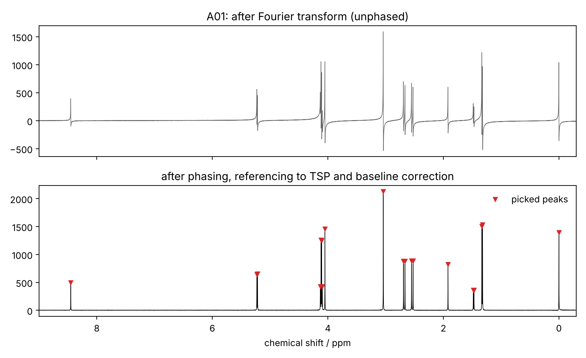
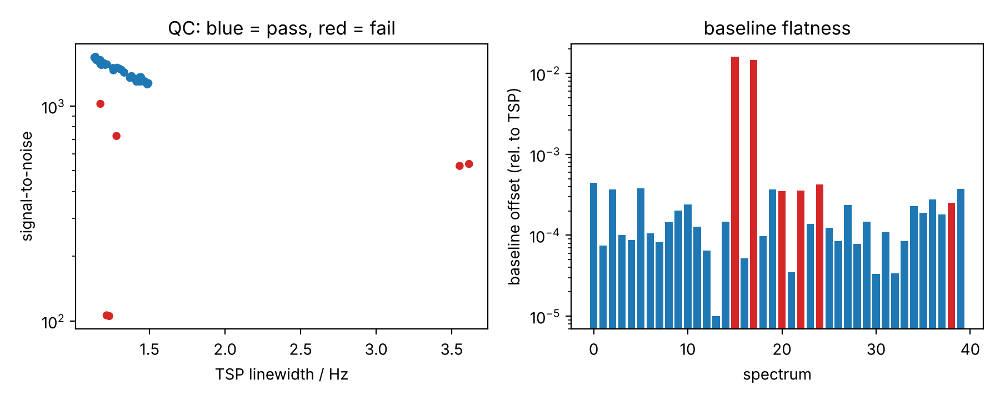
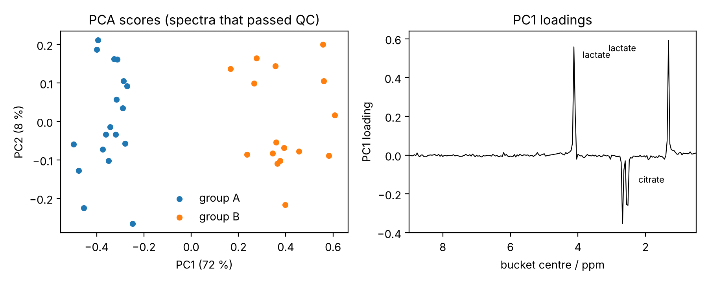

# nmr-processing-demo

A small, readable Python pipeline for 1D ¹H NMR spectra: from the raw FID to processed spectra, automatic quality control, a PCA across samples and a simple machine-learning check of the quality control.

**This is a demonstration project on simulated data, not research results.** Simulated spectra have a known ground truth, so every step can be checked: the processed spectrum should show exactly the peaks that were put in, and the quality control should flag exactly the spectra that were deliberately damaged.

Author: Dr. Chiara Luna Onorati, physical chemist (Dr. rer. nat., University of Vienna), Vienna.
I wrote this with AI assistance and worked through and checked every step myself; `docs/walkthrough.md` explains each one.



## What it does

| Step | Function | What happens |
|---|---|---|
| Simulation | `simulate.simulate_dataset` | 40 spectra (600 MHz) of an eight-component mixture with TSP as reference, two groups A and B (B has more lactate and less citrate). Random phase errors in every spectrum; 6 spectra get a deliberate problem (broad lines, low signal-to-noise, rolling baseline). |
| Apodisation, zero filling, FT | `processing.apodise`, `zero_fill`, `fourier_transform` | 0.3 Hz exponential line broadening, zero filling to 32k points, Fourier transform, ppm axis. |
| Phase correction | `processing.auto_phase` | Automatic zero- and first-order phasing by entropy minimisation (ACME, Chen et al., J. Magn. Reson. 2002). |
| Referencing | `processing.reference_to_tsp` | TSP set to exactly 0.00 ppm. |
| Baseline correction | `processing.baseline_correct` | Iterative polynomial fit to the signal-free points. |
| Peak picking | `processing.pick_peaks` | Peaks above 10 × noise (height and prominence), water region excluded. |
| Quality control | `qc.qc_report` | TSP linewidth (Hz), signal-to-noise, baseline offset; pass/fail per spectrum. |
| Chemometrics | `analysis.bin_spectrum`, `pqn_normalise`, `pca_pareto` | 0.04 ppm bucketing, probabilistic quotient normalisation, Pareto-scaled PCA on the spectra that passed QC. |
| ML check | `analysis.ml_qc_check` | Logistic regression on the three QC features, 5-fold cross-validation, compared with the fixed thresholds. |

## Results on the simulated data

- All 19 lines of the mixture are found in every spectrum.
- The fixed QC thresholds flag all 6 damaged spectra and none of the 34 good ones.
- PC1 (72 % of the variance) separates groups A and B; its loadings point to lactate (1.33 and 4.11 ppm, up in B) and citrate (2.5–2.7 ppm, down in B).
- The logistic regression classifies 38 of 40 spectra correctly. With only 6 bad examples it does no better than the thresholds. On a real facility data set with thousands of spectra, a learned model becomes useful for problems that no single threshold captures.




Tables: `results/qc_report.csv` (one row per spectrum), `results/qc_method_comparison.csv`.

## How to run

```
pip install -r requirements.txt
python run_demo.py
```

Runtime is about one minute; figures and tables are written to `results/`.

## What is simplified

- Simulated spectra: Lorentzian lines, first-order multiplets written out by hand, no strong coupling, no water signal, no real artefacts from the spectrometer.
- QC thresholds are chosen for this data set. On real data they would be set from the facility's own reference measurements.
- Reading real Bruker data would use `nmrglue` (`nmrglue.bruker.read`); the processing functions take any complex FID array.

## Licence

MIT
